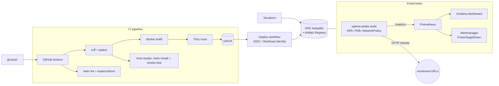

# uptime-probe

[](https://github.com/joaooln/uptime-probe/actions/workflows/ci.yml)
[](https://github.com/joaooln/uptime-probe/actions/workflows/terraform.yml)

A small HTTP availability monitor, built as an end-to-end platform engineering example:
**Python service → container → CI/CD → Kubernetes (Helm) → Prometheus/Grafana → GKE provisioned with Terraform.**

It checks a list of URLs on an interval and exports the results as Prometheus metrics,
the same job I do in production with Uptime Kuma, rebuilt here as cloud-native code.

## Architecture



## What is in the repo

| Path | What it shows |
| --- | --- |
| `app/` | FastAPI service: `/healthz`, `/readyz`, `/metrics`, `/targets` API, async checker with `httpx` |
| `tests/` | Unit tests with a mocked HTTP transport (no network needed) |
| `Dockerfile` | Multi-stage build, non-root user, healthcheck |
| `charts/uptime-probe/` | Helm chart: probes, resource limits, HPA, PDB, NetworkPolicy, restricted securityContext, optional ServiceMonitor and PrometheusRule alerts |
| `deploy/monitoring/` | kube-prometheus-stack values and a Grafana dashboard (availability %, p95 latency) |
| `infra/terraform/gke/` | VPC, GKE Autopilot, Artifact Registry and keyless GitHub → GCP auth (Workload Identity Federation) |
| `.github/workflows/` | CI (lint, test, build, scan, push, kind e2e), Terraform validate/tflint, manual GKE deploy |

## Run it

```bash
# locally
make install test
make run                       # http://localhost:8080/docs

# on a local Kubernetes cluster
make kind-up deploy smoke

# with monitoring
helm repo add prometheus-community https://prometheus-community.github.io/helm-charts
helm upgrade --install monitoring prometheus-community/kube-prometheus-stack \
  -n monitoring --create-namespace -f deploy/monitoring/kube-prometheus-values.yaml
helm upgrade --install probe charts/uptime-probe \
  --set serviceMonitor.enabled=true --set prometheusRule.enabled=true
```

### API

```bash
curl -X POST localhost:8080/targets -H 'content-type: application/json' -d '{"url":"https://example.com"}'
curl localhost:8080/targets
curl -X POST localhost:8080/targets/check     # run a check now
curl localhost:8080/metrics | grep probe_
```

Metrics: `probe_target_up`, `probe_target_latency_seconds` (histogram), `probe_checks_total`.

## Deploy to GKE

```bash
cd infra/terraform/gke
cp terraform.tfvars.example terraform.tfvars   # set project_id
terraform init && terraform apply
```

Then set the Terraform outputs as GitHub secrets/variables (listed in `deploy-gke.yml`) and run
the **Deploy to GKE** workflow. No service-account keys are stored: GitHub authenticates to GCP
with short-lived OIDC tokens restricted to this repository.

## Design notes

- **Targets come from config** (`probe.targets` in Helm values). Targets added through the API live in
  the pod's memory, so they are per-replica and lost on restart; a database (e.g. Cloud SQL / PostgreSQL)
  would be the next step for a multi-replica write API.
- Every replica probes every target, so alerts use `max by (target)` to avoid duplicates.
- The container runs as non-root with a read-only root filesystem and all capabilities dropped.

## Roadmap

- [ ] Persist targets in PostgreSQL
- [ ] GitOps deployment with Argo CD
- [ ] SLO burn-rate alerts
